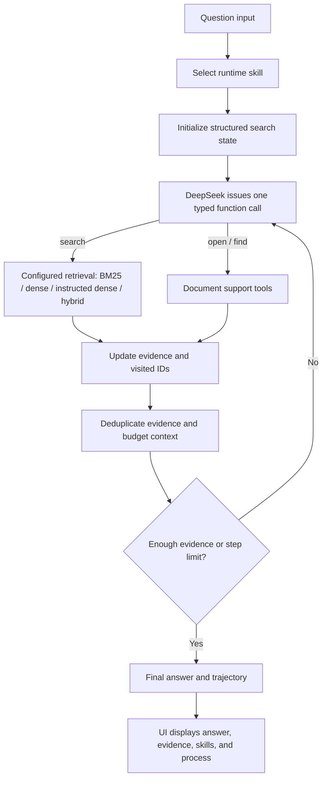

# COMP5423 Group Project Report — Draft

> Draft only. Consolidate completed experiments and add final UI screenshots before submission. Never estimate or fabricate results.

## 1. System Design Methodology

We load the COMP5423 BrowseComp-Plus validation split and the fixed Tevatron BrowseComp-Plus corpus with Hugging Face `datasets`. The local snapshot contains 100 validation questions and 100,195 corpus documents. `src.build_index` builds a BM25S sparse index; `src.build_dense_index` builds normalized BGE small document vectors and checkpoints its work for resume. The runtime can select BM25, dense, instruction-aware dense, or hybrid retrieval. Hybrid mode fuses deeper BM25 and dense candidate lists with reciprocal-rank fusion before returning the configured top-k documents. BM25 remains the default because the current end-to-end pilots did not show a hybrid accuracy gain. At question time, DeepSeek V4 Flash controls a bounded agent loop through native function calls. A search action may carry up to three distinct clue queries, and each result retains query provenance and rank. The retained configuration automatically opens the highest-ranked result after the first successful search; this policy is configurable and was selected after full validation improved. `open` reads a candidate document, `find` locates a phrase, and `answer` returns the response with supporting document IDs. The agent validates citations against opened evidence and applies a configurable two-source requirement to multi-hop identity answers; each cited source must support verified clues. Function arguments are validated before execution. Query dates more specific than the question are generalized to supported decade precision or removed. Invalid searches and repeated opens can trigger a deterministic fallback that opens the highest-scoring retrieved candidate not yet inspected. The last configured step is reserved for an answer. Context trimming preserves complete function-call/result pairs. The loop records query history, visited and opened documents, evidence, selected skills, action trajectory, API tokens, and tool calls. It enforces an eight-step limit and three-search budget, and directs the agent to inspect candidates once the search budget is exhausted. Runtime skills add multi-hop identity reasoning and search recovery guidance. Evidence and recent conversation are constrained to a fixed prompt budget. Function selection uses DeepSeek's non-thinking mode with `tool_choice="required"`.

Implementation notes: the API key is read from the local `.env` file and is never stored in prediction records. The Streamlit interface is launched from the project root with `python -m streamlit run src/app.py`; it accepts a natural-language question and displays the answer, selected skills, usage metrics, trajectory, and evidence excerpts. The UI entry point uses package imports so the documented launch command works.

## 2. System Flowchart

## 3. Result Analysis

Evaluate all 100 validation questions using normalized exact match (lowercase, punctuation and English articles removed, whitespace normalized), mean tool calls, mean model calls, and mean API tokens. The JSON-action and native-function-call runs use the same questions but differ in action protocol and thinking mode; treat this as an observed system comparison, not a controlled one-factor ablation.

| Configuration | n | normalized EM | mean tool calls | mean API tokens | Status |
|---|---:|---:|---:|---:|---|
| BM25 + iterative agent + skills + context management | 100 | 0.20 (20/100) | 3.93 | 19,726.45 | completed; `results/validation_bm25_skills_100.jsonl` |
| BM25 + skills + JSON action repair + adaptive output cap | 100 | 0.36 (36/100) | 3.69 | 28,579.82 | completed; 75 answered, 25 retry-limit stops; `results/validation_action_fix_100_v3.jsonl` |
| BM25 + skills + native function calls + answer-step reservation | 100 | 0.25 (25/100) | 4.45 | 18,997.53 | completed; 100 answered; no step-limit or retry-limit stops; `results/validation_function_calls_100.jsonl` |
| Current code + identity-skill trigger fix + evidence gate/recovery | 100 | 0.18 (18/100) | 5.52 | 23,601.57 | completed full validation; 73 abstentions; 27/27 non-abstaining answers cited opened evidence; all 52 citations valid; `results/deepseek_validation_full_current_skillfix.jsonl` |
| Current code + 3-search budget + top-k 8 | 100 | 0.15 (15/100) | 5.38 | 21,972.26 | completed full validation; 75 abstentions; all 51 citations valid; fallback opens fell from 92 to 38; `results/deepseek_validation_full_searchbudget_topk8_v3.jsonl` |
| BM25 + best-rank baseline, top-k 8, 700-character snippets, auto-open off | 100 | 0.14 (14/100) | 5.10 | 21,007.92 | completed full validation; prediction coverage 100%; 79 abstentions; 34/34 citations valid; `results/final_validation_best_rank_100.jsonl` |
| Retained configuration: BM25 + best-rank, auto-open first candidate, top-k 8 | 100 | 0.23 (23/100) | 6.47 | 24,984.45 | completed full validation; 63 abstentions; 65/65 citations valid; the pre-fix run had 1 retry-limit stop; `results/final_validation_auto_open_first_100.jsonl` |
| Search-budget change + top-k 16 candidate expansion | 100 | 0.10 (10/100) | 6.01 | 24,485.26 | completed full validation; 77 abstentions; all 35 citations valid; 109 duplicate-open fallbacks; this setting was reverted; `results/deepseek_validation_full_search_topk16_v2.jsonl` |
| Candidate-visibility state summary + top-k 8 | 100 | 0.14 (14/100) | 6.03 | 24,779.96 | completed full validation; 77 abstentions; 119 duplicate-open fallbacks and 3 retry-limit stops; state-summary change was reverted; `results/deepseek_validation_full_candidate_visibility_v4.jsonl` |
| Same BM25 agent + skills, first 10 questions | 10 | 0.40 (4/10) | 3.50 | 16,087.80 | subset of the full run |
| Same BM25 agent without skills, same first 10 questions | 10 | 0.40 (4/10) | 4.40 | 18,434.10 | completed pilot; `results/validation_bm25_no_skills_pilot10.jsonl` |
| BM25 + query-year precision sanitization, same first 5 questions | 5 | 0.60 (3/5) | 3.60 | 18,946.60 | completed pilot; `results/accuracy_tuning_pilot5_v5.jsonl`; exploratory only |
| BM25 + strict query-year precision, same first 5 questions | 5 | 0.80 (4/5) | 4.60 | 22,099.60 | completed pilot; `results/accuracy_tuning_pilot5_v6.jsonl`; exploratory only |
| Same strict-year system, next 5 questions (offset 5) | 5 | 0.20 (1/5) | 5.00 | 22,745.80 | completed non-overlapping pilot; `results/accuracy_tuning_pilot5_offset5.jsonl` |
| Same range + query provenance in agent state | 5 | 0.20 (1/5) | 4.20 | 21,258.20 | completed pilot; same EM as prior offset run; `results/accuracy_tuning_pilot5_offset5_v2.jsonl` |
| Same range + answer citation gate | 5 | 0.20 (1/5) | 4.40 | 22,764.20 | completed pilot; answer cites opened docs and multi-hop identity answers cite two sources; `results/accuracy_tuning_pilot5_offset5_v3.jsonl` |
| Invalid-action recovery | — | — | — | — | evaluated with the current code on rows 11–20; see the runs below (2 score-based fallback opens in each run) |
| Context-pair protocol repair | — | — | — | — | v4 attempt stopped after 3/5 with HTTP 400; partial run not scored; fixed by trimming whole function-call/result pairs |
| Context-pair trim fix, same range | 5 | 0.00 (0/5) | 4.80 | 25,559.60 | completed, all abstained; ran before retrieval-score retention fix; `results/accuracy_tuning_pilot5_offset5_v5.jsonl` |
| Score-preserving fallback, same range | — | — | — | — | not scored; DeepSeek rejected local API key before first prediction |
| Current code + replacement DeepSeek key, validation rows 11–20 | 10 | 0.30 (3/10) | 5.10 | 22,350.20 | completed; 7 abstentions; 8/8 citations valid; `results/deepseek_validation_offset10_pilot10.jsonl` |
| Same range after identity-skill trigger fix | 10 | 0.20 (2/10) | 5.20 | 22,029.20 | completed rerun; 5 abstentions; 10/10 citations valid; zero invalid-action retries; stochastic comparison, exploratory only; `results/deepseek_validation_offset10_pilot10_skillfix_v2.jsonl` |
| Targeted fallback-heavy range, search-budget fix, top-k 8 | 10 | 0.10 (1/10) | 5.90 | 24,150.80 | completed; search fallbacks 7→1 versus prior full-run trajectories; focused diagnostic, not an accuracy estimate; `results/deepseek_search_budget_recovery_offset77_v1.jsonl` |
| Same targeted range, top-k 16 | 10 | 0.30 (3/10) | 5.80 | 24,262.40 | completed pilot; citation validity 100%; small stochastic sample; `results/deepseek_topk16_search_recovery_offset77_v2.jsonl` |
| Same targeted range, top-k 8 + candidate-visibility state summary | 10 | 0.40 (4/10) | 5.80 | 23,363.30 | completed; 6 abstentions, 7 citations all valid; improved this focused sample, but the full run did not confirm a benefit; `results/deepseek_candidate_visibility_offset77_topk8_v1.jsonl` |
| Current code API smoke test, validation row 1 | 1 | 1.00 (1/1) | 3.00 | 17,098.00 | completed; connectivity check only, not a performance estimate; `results/deepseek_api_smoke_current.jsonl` |
| BM25 + dense retrieval fusion | — | — | — | — | implemented and evaluated below |

The first-search auto-open policy was also compared on three 10-question ranges (offsets 20, 40, and 50). It scored 8/30, compared with 5/30 for the corresponding controls; each range gained one correct answer. Mean tool calls rose from 5.30 to 6.57 and mean tokens from 21,456 to 25,494. The full 100-question run then scored 23/100 against 14/100 for the prior baseline, while mean calls and tokens rose from 5.10 to 6.47 and from 21,008 to 24,984. Citations remained valid in both runs. We retain auto-open of one candidate as the current best accuracy configuration, with the higher latency/token cost recorded. Opening two candidates on the same offset-20 batch scored 3/10, compared with 5/10 for one candidate, and also used more calls and tokens; the one-candidate setting remains. The auto-open full run had one retry-limit stop when the agent requested another document on its final turn; the agent now returns a safe abstention after final-turn retries are exhausted. That fallback was checked with a mocked-response regression run; it does not alter the 23/100 full-run score because the affected case abstained.

### Retrieval-only coverage and tuning

Literal-answer coverage checks whether the validation gold answer string occurs in any retrieved full document. It is a post-hoc retrieval diagnostic, not end-to-end accuracy; paraphrases and evidence that implies the answer do not count as hits.

| Retrieval configuration | Coverage@8 | MRR@8 | Notes |
|---|---:|---:|---|
| BM25 | 21/100 (21%) | 0.1436 | Top-100 coverage was 43/100; many answers were absent from the lexical candidate set. |
| BGE dense | 17/100 (17%) | 0.0977 | No query instruction. |
| BGE instruction-aware dense | 16/100 (16%) | 0.0883 | Query instruction did not help this metric. |
| Hybrid, pool 8, RRF 60 | 20/100 (20%) | 0.1367 | Initial fusion baseline. |
| Hybrid, pool 50, RRF 60 | 23/100 (23%) | 0.1569 | Deeper candidate pool improved coverage. |
| Hybrid, pool 100, RRF 60 | 24/100 (24%) | 0.1621 | Best pool-size result. |
| Hybrid, pool 100, RRF 100 | 25/100 (25%) | 0.1635 | One additional literal hit; RRF 200 did not improve further. |

BM25 and hybrid were also compared end-to-end on two non-overlapping ten-question pilots. BM25 scored 5/20 (25%) with 5.1 mean tool calls and 20,545 mean tokens; hybrid pool 100 scored 3/20 (15%) with 4.8 calls and 20,276 tokens. Runs are stochastic and the sample is small. Therefore BM25 remains the runtime default; hybrid is retained as an experimental option. Increasing the search budget from three to four did not improve the ten-question score (1/10) and raised mean tool calls to 7.7 and mean tokens to 31,146. Reducing the identity source threshold to one also did not improve the offset-10 pilot (2/10 vs 4/10 with the default threshold in a separate stochastic run), so the default two-source evidence gate remains. Full run files and retrieval diagnostics are logged in `report/retrieval_experiments.csv`.

### Manual current-chat-model diagnostic (separate from the project agent)

For an additional reasoning diagnostic, the current chat model manually inspected retrieved passages from the locally cached BrowseComp-Plus corpus; a Python process did not call this chat model, and DeepSeek was not used. The first-pass answers were saved before looking at the validation labels. After scoring, incorrect items were reviewed against the labels and local evidence, then written to separate revised files. The revised scores are label-informed diagnostics and must not be presented as blind evaluation results or compared directly with the API-agent runs.

| Validation range | First-pass normalized EM | Post-label diagnostic EM | First-pass evidence notes |
|---|---:|---:|---|
| Offset 20 (IDs 1218, 1221, 1228, 124, 1257) | 0.60 (3/5) | 1.00 (5/5) | 8 cited corpus documents; one unsupported answer; first-pass misses were state identification and parent/lead-character interpretation. |
| Offset 25 (IDs 130, 138, 140, 149, 15) | 0.60 (3/5) | 1.00 (5/5) | Four cited documents and one abstention; errors were film-character identification and paper identification. |

These two blind first-pass batches total 6/10 (60%). The 10/10 post-label figure reflects correction after inspecting gold labels, so it is useful for error analysis only. Full prediction records and metadata are in `results/manual_corpus_pilot_offset20.jsonl`, `results/manual_corpus_pilot_offset20_v2.jsonl`, `results/manual_corpus_pilot_offset25.jsonl`, and `results/manual_corpus_pilot_offset25_v2.jsonl`.

The failure review points to both retrieval coverage and answer selection. The full run before the search-policy change scored 18/100, had 73 abstentions, and made 92 fallback opens (48 for searches requested before opening a document; 44 for repeated opens). Allowing up to three distinct searches reduced search fallbacks to 3 and total fallback opens to 38, lowered mean tokens from 23,601.57 to 21,972.26, and completed all 100 questions. This run scored 15/100 with 75 abstentions; all 51 citations were valid. The 3-point EM difference between runs is not enough to establish a causal effect because DeepSeek responses vary.
A post-hoc retrieval diagnostic used validation answers only to check for literal answer text in retrieved full documents. Replaying the same generated queries found gold text in 53/100 candidate sets at top-k 8 and 67/100 at top-k 16. In the top-k 16 full run, the gold text appeared in 63 candidate sets and 37 opened documents, but the system scored 10/100 and made 109 repeated-open fallbacks. I reverted top-k 16. This label-guided diagnostic is for error analysis only, not a benchmark score.
The latest top-k 8 run's 75 abstentions divide into 42 questions with no literal gold answer in retrieved candidates, 26 where it appeared in a candidate but that document was not opened, and 7 where it appeared in opened evidence but the model still abstained. A candidate-visibility state summary was intended to address the second group. Its targeted 10-question run scored 4/10 versus 1/10 in an earlier run on that range, but the full run scored 14/100, had 77 abstentions, 119 repeated-open fallbacks, and 3 retry-limit stops. I reverted that state-summary change. The analyzer was also corrected to exclude rejected intermediate answer actions from answer/citation diagnostics; after correction, the candidate-visibility run had 35 valid citations and no invalid final citations.
The retained configuration uses top-k 8, permits three distinct clue searches within the search budget, and keeps the prior evidence-summary policy. Its full score is 15/100 with 100/100 prediction coverage. The next changes should target candidate discovery and opening relevant documents, while keeping answer citations tied to opened evidence and exact-match scoring unchanged. Do not increase search depth or candidate count without a fresh full end-to-end comparison.
The native-function-call run used the cached validation split and fixed corpus, DeepSeek V4 Flash, `top_k=8`, eight maximum agent steps, and three maximum searches. All 100 questions ended with an answer; none stopped at the step limit or action-retry limit. It recorded nine action corrections and 27 cases where extra model-generated function calls were ignored so only one action ran per turn. The JSON-action repair run answered 75 questions and stopped after exhausting retries on 25, despite its higher EM (36% compared with 25%). This indicates that native calls improved completion reliability in this run, while answer accuracy remains a separate weakness. Exact match measures strict normalized answer-string equality and does not award partial credit for answers that contain the correct entity plus extra text.

On the same first 10 questions, enabling skills and disabling skills both produced 4 correct answers. The skilled run used 0.9 fewer tool calls and about 2,346 fewer tokens per question on average, and had three invalid actions versus five in the no-skills run. This small, single-run pilot suggests a possible efficiency benefit, but is too small to support a broad accuracy claim. Dense and hybrid retrievers are now implemented and have separate retrieval-only results above; BM25 remains the default after the small end-to-end comparison did not confirm a hybrid accuracy gain.

Five exploratory runs on the same first five questions produced normalized EM scores of 0.40, 0.60, 0.40, 0.60, and 0.80 (v2–v6). In v6, the stricter query-year rule coincided with question 1019 (Rishi Kapoor) becoming correct; 1026 (Linus Lerner) remained incorrect. The next non-overlapping five-question range scored 1/5 (20%), with only question 1089 correct. Together, the two disjoint samples scored 5/10 (50%) with 4.8 mean tool calls and 22,422.70 mean tokens per question. This ten-question pilot shows substantial variation by question and does not establish that the year rule caused the first-range improvement. The 80% first-five result should not be treated as a general performance estimate.

Adding per-document query provenance to the agent state did not change exact-match accuracy on the next five questions (1/5 in both runs). Mean tool calls decreased from 5.0 to 4.2 and mean tokens from 22,745.80 to 21,258.20 in the second run, but the model remained stochastic and this is only a small efficiency observation. In a gold-guided local retrieval diagnostic for question 1091, a query containing “Ross Andel” retrieved the relevant corpus document near the top; the evaluated agent instead promoted Beate Peter based on a related speech-language clue and an unsupported disease hypothesis. This points to candidate verification and clue consistency as remaining weaknesses, while the diagnostic itself is not a fair end-to-end retrieval score because it uses the known answer.

The next run on the same five questions added an answer evidence gate: final answers had to cite opened documents, and multi-hop identity answers had to cite two sources. Exact match remained 1/5, with four abstentions. The correct answer to 1089 cited two opened documents (`86834` and `84756`). For 1091, this run abstained; the prior stochastic run guessed “Beate Peter,” while the gold is Ross Andel. This is consistent with better calibration, but the runs also vary stochastically, so the difference cannot be attributed to the gate alone. Exact match does not reward abstaining over a wrong answer, and the five-question sample is too small to claim a general gain. Mean tool calls and tokens rose slightly versus the provenance-only run (4.2 to 4.4 calls; 21,258.20 to 22,764.20 tokens). The expanded trajectory analysis counted 19 requested search actions and 13 executed searches. Six requests were rejected: four because the agent had to open a candidate before searching again, and two because the query had already been used. Question 1066 alone had three rejected searches and only one opened document. This exposed wasted agent steps and motivated the invalid-search recovery added after this run. Three other questions still ended with insufficient evidence, so retrieval coverage and clue resolution remain the primary bottlenecks.

The first v4 attempt stopped after 3/5 with HTTP 400 because context trimming split a function-call message from its tool reply. Trimming was changed to preserve complete pairs, and the following v5 run completed. It produced no correct answers and all five responses abstained; its exact match is 0/5. This stochastic run alone does not establish a regression. Trajectory analysis also showed the fallback did not run because retrieval scores had not been copied into the evidence state. That state bug was fixed after v5. The subsequent v6 attempt stopped before its first prediction with HTTP 401, so it has no accuracy result. After the API key was replaced, the current code completed two end-to-end runs on rows 11–20 and exercised the score-preserving fallback. The authentication blocker is resolved; answer accuracy and retrieval coverage remain open issues.

The native-function-call run averaged 6 model calls, 4.45 retrieval-tool calls, and 18,997.53 tokens per question. Its median token count was 19,767 and its 95th percentile was 28,521. The JSON-action repair run averaged 28,579.82 tokens and had 25 retry-limit stops. These measurements suggest that native calls reduced protocol failures and token use in this run, but did not improve exact-match accuracy. Retrieval quality, evidence selection, and answer reasoning remain the main areas for improvement.

The CLI analyzer reports normalized exact match over the intended evaluation range, prediction coverage, missing predictions, unknown prediction IDs, mean tool calls, mean API tokens, stop reasons, abstentions, citation validity, and requested versus executed searches. Its `--details` option adds per-question correctness, gold and predicted answers, citation IDs, opened-document counts, and search-budget diagnostics. The evaluator supports non-overlapping ranges with `--offset` and writes a metadata sidecar so interrupted runs can still be scored against the intended sample. `report/experiments.csv` stores completed runs and pending configurations. Prediction-level trajectories are retained for manual error analysis.

An additional abstention-recovery trial forced the agent to open its highest-ranked unopened candidate after exhausting the search budget. On the first ten validation items it scored 2/10, versus 1/10 in an earlier stochastic baseline, while increasing mean calls from 5.0 to 6.3 and mean tokens from 19,400 to 26,052. On the disjoint offset-10 batch it scored 3/10 versus 4/10 for the BM25 control, with mean calls increasing from 5.2 to 6.6 and tokens from 21,691 to 26,145. Per-item comparison showed no newly correct answer on the replicated batch and one previously correct answer (`Tinsel`) became an abstention. The fallback was therefore reverted. This experiment suggests that forcing inspection of a high BM25 candidate does not solve candidate relevance; future changes should improve query-to-clue targeting or candidate ranking, and be compared on the same fixed range.

Additional retrieval tuning examined answer coverage as BM25 `top_k` increased and replayed the agent's saved multi-query batches with different RRF settings. Full-question literal-answer coverage rose from 21/100 at `top_k=8` to 25/100 at 12, 27/100 at 20, and 33/100 at 30. Yet two same-range `top_k=12` end-to-end pilots scored 1/10 and 3/10, versus 1/10 and 4/10 for the `top_k=8` controls; the higher candidate count did not improve accuracy and one previously correct answer was lost. In strict word-boundary query-batch replay, increasing each query's RRF input depth from 16 to 64 raised coverage only from 51/100 to 54/100 while MRR fell from 0.2283 to 0.1907. Changing the query-fusion RRF constant from 60 to 10 kept replay coverage at 51/100 and raised MRR slightly to 0.2342, but two API pilots scored 4/20 combined versus 5/20 for the top-k 8, RRF 60 controls. The offline replay uses model-generated queries from a completed run and is a retrieval diagnostic, not an independent end-to-end result.

A query-fusion policy sweep compared RRF, round-robin diversification, a two-results-per-query quota, and best-rank sorting on the saved 100-question search trajectories. Best-rank had the highest diagnostic MRR (0.2370 vs. 0.2283 for RRF) at the same 51/100 literal-answer coverage. We implemented it as a selectable mode and tested it against RRF on the same three disjoint 10-question ranges. Best-rank scored 4/10, 2/10, and 3/10; RRF scored 1/10, 4/10, and 2/10. Combined, this is 9/30 vs. 7/30, with mean tool calls 4.77 vs. 5.03 and mean tokens 20,149 vs. 20,543. The offset-10 range regressed, so this is a modest exploratory advantage rather than a reliable estimate. We keep `QUERY_FUSION_MODE=best_rank` as the current measured best, while retaining `QUERY_FUSION_MODE=rrf` as a one-variable rollback. `top_k=8`, RRF `k=60`, and per-query depth 16 remain unchanged.

A CPU Cross-Encoder reranking trial used `cross-encoder/ms-marco-MiniLM-L6-v2` to reorder depth-16 BM25 results for each query before best-rank fusion. On a post-hoc replay of the saved 100-question search queries, strict literal-answer coverage changed from 51/100 to 52/100, while MRR dropped from 0.2366 to 0.1671. Scoring 12,032 query-document pairs took 278.7 seconds on this CPU-only machine. Given the negligible coverage change, lower MRR, and added latency, the reranker was not added to the application. The model card documents the CrossEncoder inference interface at [Hugging Face](https://huggingface.co/cross-encoder/ms-marco-MiniLM-L6-v2).

The search-result snippet currently shows the first 700 document characters. In 100 saved trajectories, 51 questions had at least one retrieved full document containing the literal gold answer; the answer appeared in the displayed prefix for 26 of those questions. Longer prefixes raised answer visibility to 28/100 at 1,000 characters, 35/100 at 1,500, and 37/100 at 2,000. A query-term-focused window performed worse than the prefix at each tested length. We exposed `SEARCH_SNIPPET_CHARS` for controlled experiments, then tested 1,500 characters on two disjoint 10-question batches. It scored 3/20 versus 6/20 for the same-range 700-character best-rank controls, with mean API tokens increasing from 21,319 to 21,821 and mean abstentions increasing from 7 to 8 per 10 questions. We keep 700 as the default; the longer snippet did not translate into better answer selection.

Failure analysis of the 30 best-rank pilot answers found 9 correct answers, 21 abstentions, and no incorrect non-abstaining answers. Literal gold text appeared in a retrieved full document for 16 questions; the agent opened such a document for 10, and 6 had a matching retrieved candidate that it did not open. In 14 questions, no retrieved full document contained the literal gold answer; only one abstention happened after the agent opened a document containing the answer. This keeps retrieval recall as the main target while preserving the current evidence gate. Title-only BM25 fusion did not help: it gave at most 20/100 literal-answer hits versus 21/100 for body BM25. An earlier seven-setting `k1`/`b` sweep is withdrawn: it changed scoring attributes after the index had already precomputed document scores, so its unchanged results were invalid. The corrected sweep rebuilt each index and is reported below.

### Rebuilt BM25 scoring variants

To correct the invalid parameter sweep, each variant was indexed from the full 100,195-document corpus with its own scoring method and parameters, then replayed against the same saved validation queries (candidate depth 16, top-k 8, best-rank fusion). Strict literal-answer coverage was 51/100 for current Lucene BM25, 52/100 for rebuilt Lucene BM25 with `k1=0.9,b=0.5`, 53/100 for BM25L (`k1=1.5,b=0.75,delta=0.5`), and 51/100 for BM25+. MRR was 0.2370, 0.2041, 0.2331, and 0.2370 respectively. The small BM25L coverage increase makes it a candidate, not a confirmed accuracy gain.

We then ran a paired end-to-end comparison on validation offset 40, 10 questions each, with identical agent configuration. Lucene BM25 scored 1/10 with 5.3 mean tool calls and 20,860 mean tokens; BM25L also scored 1/10 with 4.6 calls and 19,242 tokens, and both runs abstained on 8 questions. Thus BM25L used fewer calls and tokens on this batch, but did not improve exact-match accuracy. We retain Lucene BM25 as the accuracy-first default and keep BM25L available as a documented experimental index; a larger paired batch is needed before promoting it. The two prediction artifacts and per-run metadata record the index method and parameters. See `results/retrieval_bm25_rebuilt_scoring_sweep.json` and `report/retrieval_experiments.csv`.

Two further offline candidates were rejected before spending API calls. Pseudo-relevance feedback took up to five terms shared by the top three BM25 documents and appended them to each saved query. In a flattened saved-query replay, literal-answer hits changed from 47/100 to 48/100, but MRR fell from 0.2786 to 0.2550; feedback from only the top document yielded 46/100. Fusing Lucene BM25 and BM25L rankings did not beat BM25L alone in the same replay: BM25L reached 48/100, while cross-retriever best-rank and equal-weight RRF each reached 47/100. These exploratory replay metrics use a different query aggregation procedure from the rebuilt-scoring sweep above, so compare variants only within each replay artifact. Neither feedback expansion nor dual-index fusion was added to the runtime.

We tested expanding each search action from at most two to three extra clue queries. On a paired offset-30 validation range, the existing two-query limit scored 3/10, while the expanded limit scored 2/10; mean tool calls rose from 5.0 to 5.7 and mean tokens from 21,234 to 24,844. The model used three extra queries on only 2 of 28 search actions, and the expanded run had one invalid-action retry. We keep `MAX_ADDITIONAL_QUERIES=2`; further work should focus on making the existing independent queries more discriminative rather than widening the query list.

## 4. User Interface Design

The Streamlit page accepts a question in the **Research question** text box; the user presses **Ctrl+Enter** to apply the text, then **Search** to run the agent. The answer and usage metrics appear first. Expand **Agent trajectory** to inspect each action and result, or **Collected evidence** to inspect the supporting excerpts. The local UI was opened with validation question 1005 and returned **Folke Karl Skoog**, one tool call, and 6,125 API tokens. An actual browser capture of this result view was taken during development; add that image file to this section before final submission.

## 5. Additional Exploration (Optional)

Potential follow-up work includes improving candidate ranking and answer-focused evidence selection, then validating promising changes on a larger fixed subset. Keep retrieval-only coverage diagnostics separate from end-to-end normalized exact match, and include only completed experiments in the final report.
